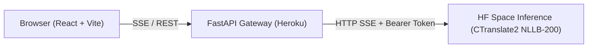

# BalkanTranslate (BS / SR / ME ↔ UK)

Neural machine translation web application for **Bosnian / Serbian / Montenegrin (`bos_Latn`) ↔ Ukrainian (`ukr_Cyrl`)**, built with **FastAPI**, **React + TypeScript + Tailwind CSS**, and a fine-tuned **NLLB-200-600M-distilled** model converted to **CTranslate2 (int8)**.

> **Live Demo:** `<LIVE_DEMO_URL>` *(deploy gateway to Heroku + inference to Hugging Face Spaces)*
>
> **Demo Preview:** `<!-- Add screenshot or GIF here:  -->`

---

## Architecture

This branch implements **Option A: Split Services (Gateway + Hosted Inference)**:



- **Frontend (`frontend/`)**: React 19 + TypeScript + Tailwind CSS. Handles SSE text streaming, drag-and-drop file translation (`.txt`, `.docx`, `.html`), inference cold-start ("Waking up") status badges, and 55s request timeouts.
- **Gateway (`backend/`)**: Slim FastAPI service (no `torch`, `ctranslate2`, or CUDA dependencies). Provides:
  - Per-IP + signed-cookie token-bucket rate limiting (`backend/app/rate_limiter.py`).
  - `TranslatorBackend` abstraction with `RemoteBackend` calling Hugging Face Spaces off the event loop (`backend/app/backends.py`).
  - Async file-translation jobs (`POST /translate/file/submit`, `GET /translate/file/status`, `GET /translate/file/result`) with TTL cleanup to stay within Heroku's 30s first-byte limit.
- **Training & Conversion (`training/`)**: Scripts and requirements for fine-tuning NLLB-200, converting to CTranslate2 (`int8`), and evaluating BLEU/chrF++ scores.

---

## Quick Start

### 1. Run with Docker Compose

```bash
export REMOTE_INFERENCE_URL="https://your-space.hf.space"
export REMOTE_API_TOKEN="hf_..."   # optional if Space is public
docker compose up --build
```

- Frontend: `http://localhost`
- Backend API: `http://localhost:8000`

### 2. Local Development (without Docker)

**Backend:**

```bash
cd backend
python -m venv .venv
source .venv/bin/activate
pip install -r requirements-dev.txt
cp .env.example .env   # set REMOTE_INFERENCE_URL
uvicorn app.main:app --reload --port 8000
```

**Frontend:**

```bash
cd frontend
npm ci --legacy-peer-deps
npm run dev
```

Vite proxies `/translate` and `/health` to `http://localhost:8000` by default (override with `VITE_PROXY_TARGET`).

### 3. Deploying to Heroku + Hugging Face Spaces

1. **Hugging Face Space**: Host the CTranslate2 model + tokenizer and expose `/health` and `/translate/stream` (see `training/README.md`).
2. **Heroku Gateway**:
   ```bash
   heroku stack:set container
   heroku config:set REMOTE_INFERENCE_URL="https://your-space.hf.space"
   heroku config:set REMOTE_API_TOKEN="hf_..."
   heroku config:set COOKIE_SECRET="$(openssl rand -hex 32)"
   heroku config:set CORS_ORIGINS="https://your-frontend.example.com"
   git push heroku main
   ```

---

## API Reference

| Method | Endpoint | Description |
| :--- | :--- | :--- |
| `GET` | `/health` | Gateway metrics + remote inference reachability (`Normal` / `Waking up`) |
| `POST` | `/translate/stream` | Stream text translation via Server-Sent Events (`text`, `source_lang`, `target_lang`) |
| `POST` | `/translate/file` | Synchronous `.txt`/`.docx`/`.html` translation (returns translated file; `?debug=true` returns ZIP) |
| `POST` | `/translate/file/stream` | Stream chunk-by-chunk file translation progress via SSE and store result by `job_id` |
| `POST` | `/translate/file/submit` | Submit async file job and return `job_id` immediately (Heroku 30s limit safe) |
| `GET` | `/translate/file/status` | Poll async file job status and chunk progress (`?job_id=...`) |
| `GET` | `/translate/file/result` | Download completed translated file (`?job_id=...`) |

---

## Evaluation & Research

- **Base Model:** `facebook/nllb-200-distilled-600M`
- **Fine-tuned Model & Dataset:** `<HUGGINGFACE_MODEL_URL>` / `<HUGGINGFACE_DATASET_URL>`
- **Paper:** `<PAPER_LINK_OR_CITATION>`

| Model | Direction | BLEU | chrF++ | Notes |
| :--- | :--- | :---: | :---: | :--- |
| Base NLLB-200-600M | `bos_Latn -> ukr_Cyrl` | *TBD* | *TBD* | Run `training/` eval script |
| Fine-tuned (int8 CT2) | `bos_Latn -> ukr_Cyrl` | *TBD* | *TBD* | Run `training/` eval script |

---

## Testing & Linting

```bash
# Backend
ruff check backend
pytest

# Frontend
cd frontend
npm run lint
npm run build
```

---

## Limitations

- **Cold Starts:** Free-tier Hugging Face Spaces sleep after inactivity; the first translation may take 30–60 seconds while the model loads.
- **In-Process State:** Rate-limit buckets and async file job results are stored in memory on a single gateway instance (Redis-backed storage is planned for Phase 3).
- **Sentence Splitting:** Uses a regex-based splitter; complex abbreviations in Bosnian/Serbian/Croatian may occasionally split mid-sentence.
- **Text Length:** Single `/translate/stream` requests are capped at `2000` characters; use file upload for longer documents.

---

## License & Credits

- **Model Credits:** Built on **NLLB-200** (*No Language Left Behind*) by **Meta AI** (`facebook/nllb-200-distilled-600M`).
- **Model License:** NLLB-200 weights are released under **CC-BY-NC 4.0** (non-commercial use only). Any fine-tuned derivatives inherit this restriction.
- **Inference Engine:** [CTranslate2](https://github.com/OpenNMT/CTranslate2) (`int8` quantization).
