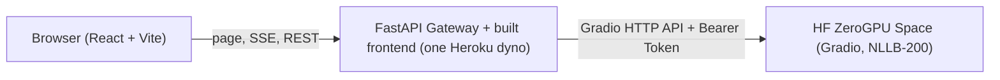

# BalkanTranslate (BS / SR / ME ↔ UK)

Neural machine translation web application for **Bosnian / Serbian / Montenegrin (`bos_Latn`) ↔ Ukrainian (`ukr_Cyrl`)**, built with **FastAPI**, **React + TypeScript + Tailwind CSS**, and a fine-tuned **NLLB-200-600M-distilled** model hosted on a **Hugging Face ZeroGPU Space**.

> **Live Demo:** `<LIVE_DEMO_URL>` *(deploy gateway to Heroku + inference to Hugging Face Spaces)*
>
> **Demo Preview:** `<!-- Add screenshot or GIF here:  -->`

---

## Architecture

This branch implements **Option A: Split Services (Gateway + Hosted Inference)**:



- **Frontend (`frontend/`)**: React 19 + TypeScript + Tailwind CSS. Text translation, file translation (`.txt`, `.docx`, `.html`) with progress, and inference status badges.
- **Gateway (`backend/`)**: Slim FastAPI service without model dependencies. Provides:
  - Per-IP rate limiting with a signed anonymous-session cookie.
  - `TranslatorBackend` abstraction with `GradioBackend` calling the Space.
  - Batching that keeps requests within the model's token limit and saves GPU quota.
  - A simple in-process queue for file jobs (submit, poll, download, cancel).
- **Training & Conversion (`training/`)**: Scripts and requirements for fine-tuning NLLB-200, converting to CTranslate2 (`int8`), and evaluating BLEU/chrF++ scores.

---

## Quick Start

### 1. Run with Docker Compose

```bash
export REMOTE_INFERENCE_URL="https://danlike-nllb-200-600-endpoint.hf.space"
export REMOTE_API_TOKEN="hf_..."   # GPU time is charged to this account
docker compose up --build
```

Open `http://localhost`. One container serves both the web page and the API, on this machine only.

### 2. Local Development (without Docker)

**Backend:**

```bash
cd backend
python -m venv .venv
source .venv/bin/activate
pip install -r requirements-dev.txt
cp .env.example .env   # set REMOTE_INFERENCE_URL
uvicorn app.main:app --reload --port 8000
```

**Frontend:**

```bash
cd frontend
npm ci --legacy-peer-deps
npm run dev
```

Vite proxies `/translate` and `/health` to `http://localhost:8000` by default (override with `VITE_PROXY_TARGET`).

### 3. Deploying to Heroku + Hugging Face Spaces

1. **Hugging Face Space**: a Gradio ZeroGPU Space with a `/translate` endpoint taking `(text, direction)`, where `direction` is `bs-ua` or `ua-bs` (currently [`Danlike/NLLB-200-600-endpoint`](https://huggingface.co/spaces/Danlike/NLLB-200-600-endpoint)). All visitors share the daily GPU quota of the token owner.
2. **Heroku app** (web page and API; the root `Dockerfile` builds both):
   ```bash
   heroku create <app-name> --stack container
   heroku config:set -a <app-name> \
     REMOTE_INFERENCE_URL="https://danlike-nllb-200-600-endpoint.hf.space" \
     COOKIE_SECRET="$(openssl rand -hex 32)"
   # add REMOTE_API_TOKEN in the dashboard (Settings -> Config Vars)
   heroku git:remote -a <app-name>
   git push heroku main
   ```

To host the frontend elsewhere instead, build it with `VITE_API_URL=<gateway URL> npm run build` and set `CORS_ORIGINS` on the gateway to its address.

---

## API Reference

| Method | Endpoint | Description |
| :--- | :--- | :--- |
| `GET` | `/health` | Inference reachability and file queue length |
| `POST` | `/translate/stream` | Stream text translation via Server-Sent Events (`text`, `source_lang`, `target_lang`) |
| `POST` | `/translate/file/submit` | Queue a file (up to 3 MB and 20,000 characters) and return `job_id` |
| `GET` | `/translate/file/status` | Job status and progress (`?job_id=...`) |
| `GET` | `/translate/file/result` | Download the translated file (`?job_id=...`) |
| `DELETE` | `/translate/file/job` | Cancel a queued or running job (`?job_id=...`) |

---

## Evaluation & Research

- **Base Model:** `facebook/nllb-200-distilled-600M`
- **Fine-tuned Model & Dataset:** `<HUGGINGFACE_MODEL_URL>` / `<HUGGINGFACE_DATASET_URL>`
- **Paper:** `<PAPER_LINK_OR_CITATION>`

| Model | Direction | BLEU | chrF++ | Notes |
| :--- | :--- | :---: | :---: | :--- |
| Base NLLB-200-600M | `bos_Latn -> ukr_Cyrl` | *TBD* | *TBD* | Run `training/` eval script |
| Fine-tuned (int8 CT2) | `bos_Latn -> ukr_Cyrl` | *TBD* | *TBD* | Run `training/` eval script |

---

## Testing & Linting

```bash
# Backend
ruff check backend
pytest

# Frontend
cd frontend
npm test
npm run lint
npm run build
```

---

## Limitations

- **Cold Starts:** Free-tier Hugging Face Spaces sleep after inactivity; the first translation may take 30–60 seconds while the model loads.
- **GPU Quota:** All visitors share the daily ZeroGPU quota of the token owner.
- **In-Process State:** Rate-limit buckets, the file queue and results live in memory of a single gateway instance and are lost on restart.
- **Documents:** `.docx` translation covers body paragraphs only (not tables, headers or footers); `.html` output keeps paragraph text only.
- **Sentence Splitting:** Regex-based; abbreviations may split mid-sentence. Sentences over 220 characters are cut at a clause or word boundary to fit the model, which can affect quality.
- **Text Length:** `/translate/stream` requests are capped at 2000 characters; use file upload for longer documents.

---

## License & Credits

- **Model Credits:** Built on **NLLB-200** (*No Language Left Behind*) by **Meta AI** (`facebook/nllb-200-distilled-600M`).
- **Model License:** NLLB-200 weights are released under **CC-BY-NC 4.0** (non-commercial use only). Any fine-tuned derivatives inherit this restriction.
- **Inference:** Hugging Face ZeroGPU Space (Gradio, PyTorch).
